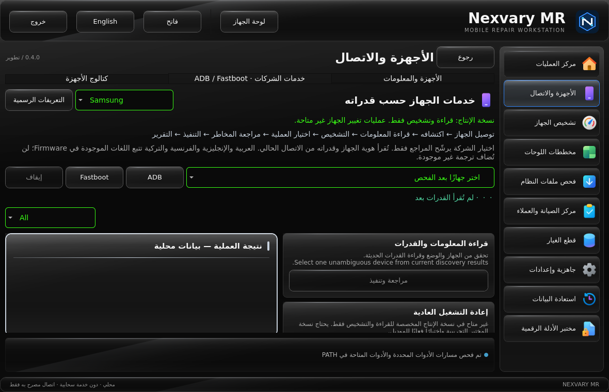
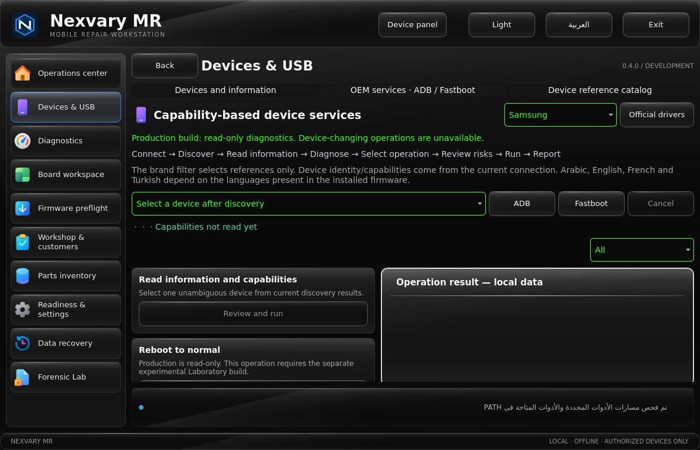

# Local validation — 2026-10-23 (Cairo)

These are actual local results, not GitHub Actions, Windows or physical-phone results.
The code was tested before the integration commit was created. Remote exact-head CI
is a separate promotion gate; its URLs/status are recorded in PR #8.

| Check | Result |
| --- | --- |
| Ubuntu 24.04 / GCC 13 / Qt 6.4.2 production Release build, warnings as errors | Passed |
| Production CTest | 17/17 groups passed, 68.08 seconds |
| Separate Laboratory Release build, warnings as errors | Passed |
| Laboratory CTest | 17/17 groups passed, 70.21 seconds |
| Production service suite | 24 passed, 0 failed, 21 explicitly Laboratory-only fixture skips |
| Laboratory service suite | 45 passed, 0 failed, 0 skipped |
| Device-tool cases per profile | 17 passed, 0 failed (includes timeout/cancel/duplicate identity cases) |
| Qt/QML UI cases per profile | 25 passed, 0 failed; AR/EN, light/dark, minimum size, navigation/back/exit |
| Python application + RC evidence gate | 9/9 passed |
| Python synthetic recovery | 19/19 passed |
| Python tracking portal | 6/6 passed |
| Real native Qt -> verified Caddy TLS -> Gunicorn | Passed: authenticated publish, status, revocation, log redaction |
| Server installer | Shell syntax, generated bundle and dry-run passed |
| Git whitespace check; workflow YAML parse | Passed |

The real TLS fixture used the project's pinned Caddy **2.11.7** archive with verified
SHA-256 `727b91701a392de6ebc5027509f548bf39979e5216340d0faed8fa5e69c84f8b`
and hash-locked Gunicorn **26.2.0**. The distribution Caddy 2.6.2 could not parse the
current config; that failed exploratory attempt is not counted as acceptance.
Native TSK **4.12.1** and ClamAV **1.5.3** were separately installed and exercised
against synthetic fixtures, not customer data or a real phone.

## Interpretation and limits

- Ordinary CTest leaves one real-server credential-dependent cloud case skipped;
  the separate real-TLS integration executes that case with temporary credentials
  and its temporary CA. Production's 21 service fixture skips are device-write
  positives executed in the separate Laboratory suite, not bypassed production checks.
- The production suite verifies that fully supplied consent and an environment
  variable cannot enable writes or start any extra child process. Approval maps
  also reject string/numeric booleans before process launch.
- The first overlapping workspace build attempts produced non-executable or
  malformed local build outputs. Those attempts failed and are excluded. Final
  evidence came from fresh, isolated `/tmp` builds run sequentially, without
  repairing binary headers or ignoring failed checks.
- Qt 6.4 offscreen QuickTest can emit a pending-item warning at engine shutdown.
  The native smoke run and both QML suites passed. This is not a substitute for
  human review on the target Windows Qt 6.8.3 runtime.
- No Android physical-device test, clean Windows 10/11 acceptance, Authenticode
  signing, installer/portable test on this new Windows build, systemd VM upgrade,
  complete dependency/SBOM review, or release approval is claimed.
- Package preflight is structural only; payload CRC, APK/firmware signing and
  model compatibility remain unverified. Service reports exclude raw identifiers
  and logs, but technical metadata/hashes still need review before sharing.
- **RC and stage 60 remain blocked. No commercial release was published.**

## Reviewable evidence

Text/XML results are under [evidence](evidence/). Actual production offscreen captures:

See [the stage checkpoint](DEVELOPMENT_CHECKPOINT_2026-10-23.md) for continuation
commands, implemented capability scope and remaining gates.
