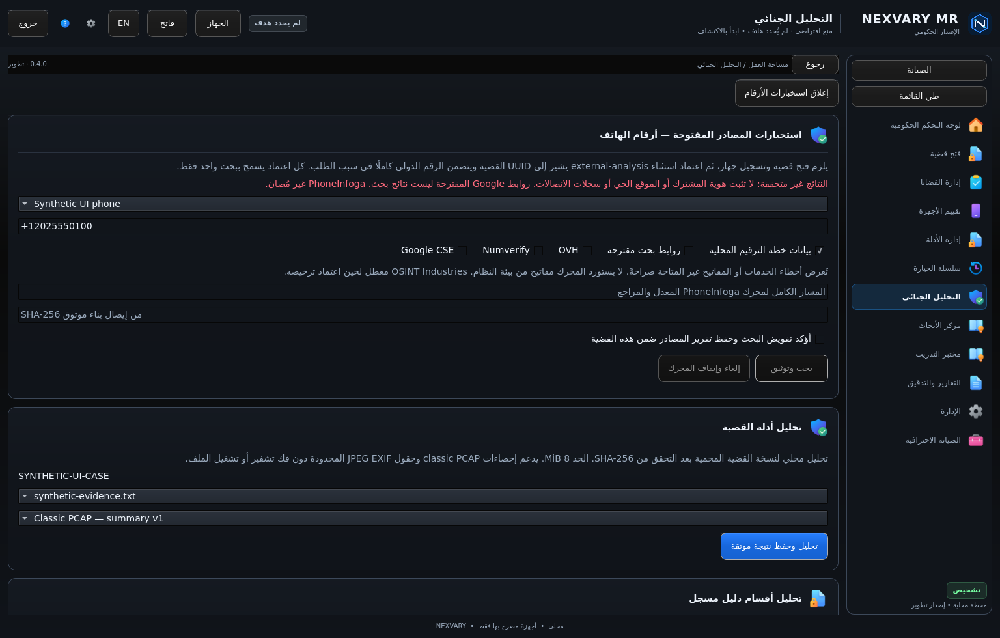
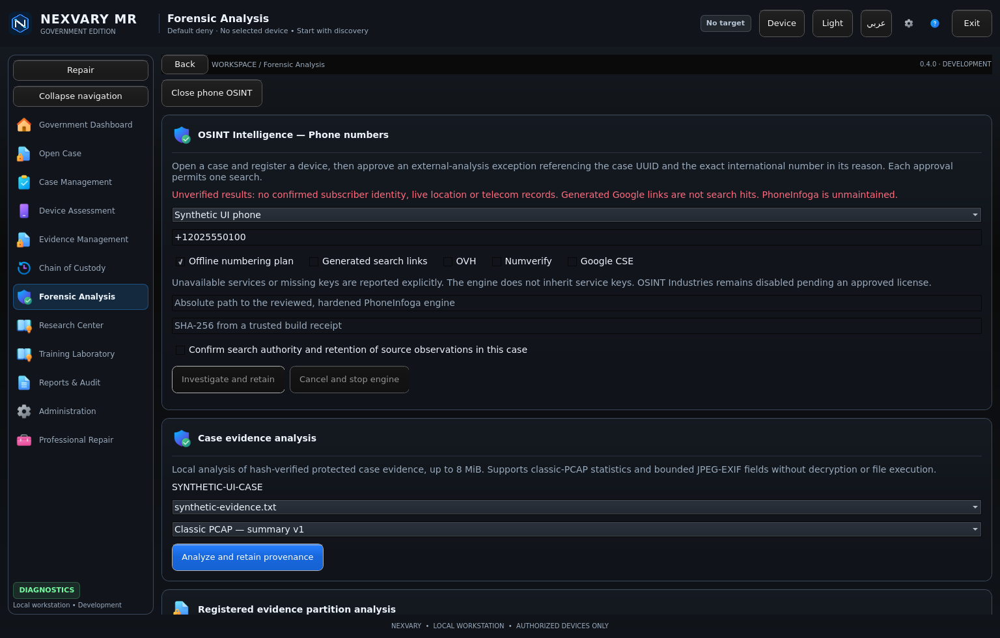

# Phone OSINT integration — verification evidence

Product source: `a9652a4b0ce789ff0a6ac629a0945e4db58827cc` on `feature/government-operations`.
Local source tree: `6c6e4518996047b1f472f30039e91222bd86d37b` (matches the product commit).

The final local full native run passed **51/51 CTest suites**, including normal GUI, 125%/150% scale and smoke tests. The main Qt UI run passed **55 tests**. Legacy Python, research and Android recovery suites passed **42 / 2 / 19** tests. The actual modified upstream engine passed the native provider's real-engine test; mock observations are explicitly synthetic and are never used as investigative findings.

The engine recipe passed module verification, upstream scanner/API tests, private-session security tests, source vendoring and govulncheck v1.9.0 with Go 1.26.10 (zero findings). The included Linux receipt predates only the checkout-byte fix; a fresh CRLF simulation produced the same executable digest. Complete current platform receipts and vendored corresponding source are included in CI engine artifacts.

Dedicated provider/engine CI: https://github.com/nexvary/NEXVARY-MR/actions/runs/41638905805
Full Windows/Linux evaluation build (all seven jobs passed): https://github.com/nexvary/NEXVARY-MR/actions/runs/41638917548
Pull request: https://github.com/nexvary/NEXVARY-MR/pull/15
Technical architecture/license report: https://github.com/nexvary/NEXVARY-MR/blob/a9652a4b0ce789ff0a6ac629a0945e4db58827cc/docs/osint/PHONEINFOGA_INTEGRATION.md

Delivery report: [INTEGRATION_REPORT.md](INTEGRATION_REPORT.md)

## Important limits

This is phone-number OSINT, not verified subscriber identification, live tracking or telecom-record access. Generated Google links are not observed search hits. Commercial API keys are not configured/inherited; unavailable scanners report errors. OSINT Industries is disabled.

Searches require a permitted active case, a registered device, consent and independent review tied to the case UUID and exact normalized number. One approval allows one search. Results enter protected evidence/custody/audit storage and normal evidence export controls. Original approval/session/case state is rechecked; cancellation/revocation withholds results.

OSINT case evidence and the policy receipt are separate durable commits; interrupted/incomplete receipts require review. Existing institutional identity, signing, power-loss, physical Windows/device evaluation and the earlier Government audit-store lag blocker remain outside this integration's verified claims. No ministry or other authority has been contacted.

Final acceptance: all seven PR CI jobs passed; Windows production/laboratory passed 54/54 CTest suites. The installer, installed runtime, uninstall and portable smoke checks passed. See INTEGRATION_REPORT.md and final-ci-and-artifacts.json for exact artifacts and source-tree equivalence.

## Screenshots

Actual Qt render, synthetic test profile:

